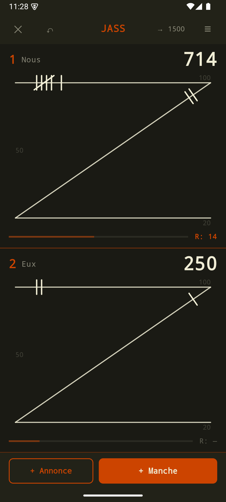
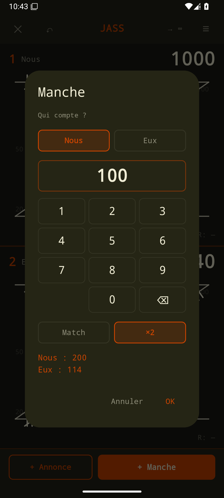
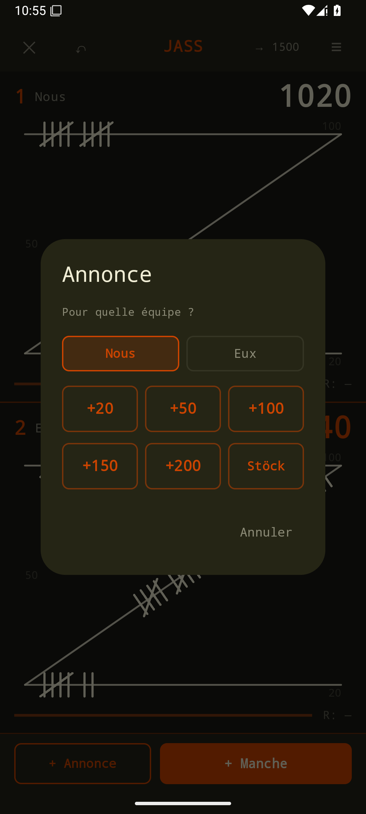

# Jass Score

Application Android pour compter les points au **Jass**, comme sur une ardoise classique : un grand Z par équipe, des barres de 100, 50 et 20 tracées en travers des traits, et la retenue notée à côté.

<p align="center">
  
  
  
</p>

## Installation

1. Sur ton téléphone, ouvre la [dernière version](https://github.com/Largy-dev/Jass/releases/latest) et télécharge **`Jass-Score.apk`**.
2. Ouvre le fichier. À la première installation, Android demande d'autoriser « Installer des applications inconnues » pour ton navigateur.

**Mises à jour :** télécharge simplement le nouvel APK et ouvre-le. L'app est mise à jour par-dessus l'ancienne et **la partie en cours est conservée**. Pas besoin de désinstaller.

> Seule exception : les anciennes versions (« 1.0 » ou « 2.0 » sans numéro de build) étaient signées avec une clé temporaire. Désinstalle-les une dernière fois avant d'installer une version 2.0.x.

Android 8.0 (API 26) minimum.

## Utilisation

| Geste | Effet |
|---|---|
| Tap sur un trait du Z | +1 barre (haut = 100, diagonale = 50, bas = 20) |
| Appui long sur un trait | −1 barre |
| Tap sur le nom d'une équipe | Renommer l'équipe |
| **+ Manche** | Choisir l'équipe qui compte, taper ses points (0–157) : l'autre reçoit le complément à 157. Options **Match** (257 / 0) et **×2** (pique double) |
| **+ Annonce** | Wys 20, 50, 100, 150, 200 ou **Stöck** (+20) pour l'équipe choisie |
| ✕ | Nouvelle partie (avec confirmation, noms et objectif conservés) |
| ↶ | Annuler la dernière action |
| → 1500 | Objectif de la partie : 1000, 1500, 2500, 3000, autre valeur ou aucun |
| ≡ | Historique, avec « Annuler la dernière » |

**Retenue (R:)** — les points d'une manche ou d'une annonce sont convertis en barres de 100, 50 et 20. Le reste (0 à 19) est gardé en retenue et ajouté au calcul suivant. Le total affiché inclut la retenue.

**Victoire** — dès qu'une équipe atteint l'objectif en étant devant, un dialogue l'annonce (« Nouvelle partie » ou « Continuer »).

La partie est sauvegardée automatiquement à chaque action. En paysage, les deux ardoises s'affichent côte à côte.

## Développement

Kotlin + Jetpack Compose (Material 3), sans autre dépendance.

```
app/src/main/java/com/largy/jass/
├── game/              Logique pure, sans Android (testée)
│   ├── Game.kt          Team, Zone, TeamScore, GameEvent, Scores, Rules
│   └── EventCodec.kt    Sérialisation texte pour la sauvegarde
├── GameViewModel.kt   État de l'écran + sauvegarde (SharedPreferences)
├── MainActivity.kt
└── ui/
    ├── JassApp.kt       Écran principal, barres du haut et du bas
    ├── SlateBoard.kt    Ardoise en Z : dessin des barres, détection du trait touché
    ├── RoundDialogs.kt  Saisie de manche (pavé numérique) et d'annonce
    ├── GameDialogs.kt   Renommer, nouvelle partie, objectif, victoire, historique
    └── theme/           Palette « ardoise » et typographie
```

L'état de la partie est une **liste d'événements** (barre ajoutée/retirée, manche, annonce). Les scores sont recalculés en rejouant cette liste, ce qui rend l'annulation triviale et la sauvegarde compacte.

### Compiler et tester

Prérequis : JDK 17 et SDK Android 36 (ou Android Studio).

```bash
./gradlew testDebugUnitTest   # tests unitaires de la logique de jeu
./gradlew assembleDebug       # APK debug : app/build/outputs/apk/debug/
./gradlew assembleRelease     # APK release signé (voir Signature)
./gradlew bundleRelease       # AAB pour le Play Store
```

### Intégration continue

À chaque push sur `main`, GitHub Actions ([`build.yml`](.github/workflows/build.yml)) :

1. lance les tests unitaires ;
2. compile l'APK et l'AAB **release signés**, avec `versionCode` = numéro du run (toujours croissant) et `versionName` = `2.0.<run>` ;
3. remplace la release [`latest-build`](https://github.com/Largy-dev/Jass/releases/latest) par les nouveaux `Jass-Score.apk` et `Jass-Score.aab`.

## Signature

Android n'accepte une mise à jour que si elle est signée **avec la même clé** que l'app installée. La clé de l'app (« upload key ») est donc stable et **ne doit jamais être perdue ni versionnée**.

- **En local**, Gradle lit `~/.jass-signing/keystore.properties` (ou le chemin indiqué par la variable `JASS_SIGNING_PROPERTIES`) :

  ```properties
  storeFile=C:/Users/<toi>/.jass-signing/jass-upload.jks
  storePassword=...
  keyAlias=jass
  keyPassword=...
  ```

  Sans ce fichier, le build release est produit non signé ; le debug reste utilisable.

- **En CI**, la clé vient de trois secrets GitHub (Settings → Secrets and variables → Actions) :

  | Secret | Contenu |
  |---|---|
  | `JASS_KEYSTORE_BASE64` | le fichier `.jks` encodé en base64 |
  | `JASS_KEYSTORE_PASSWORD` | mot de passe du keystore et de la clé |
  | `JASS_KEY_ALIAS` | `jass` |

  Sans ces secrets, la CI échoue volontairement plutôt que de publier un APK impossible à mettre à jour.

> **Sauvegarde le dossier `~/.jass-signing/`** (gestionnaire de mots de passe, clé USB…). Sans lui, plus aucune mise à jour n'est possible pour les téléphones où l'app est installée.

## Google Play Store

L'AAB signé (`Jass-Score.aab`) est prêt à être envoyé sur la Play Console. À la création de l'app, Google propose la **signature d'application par Google Play** :

- **Recommandé ici :** fournir **ta propre clé** comme clé de signature d'application (option d'export depuis un keystore Java, avec l'outil PEPK fourni par la Play Console, appliqué à `jass-upload.jks`). L'app du Play Store aura alors la même signature que l'APK de GitHub, et les deux restent interchangeables sans désinstaller.
- Si tu laisses Google générer la clé, le Play Store signera avec une clé différente : passer de l'APK GitHub à la version Play Store demandera une désinstallation unique.
